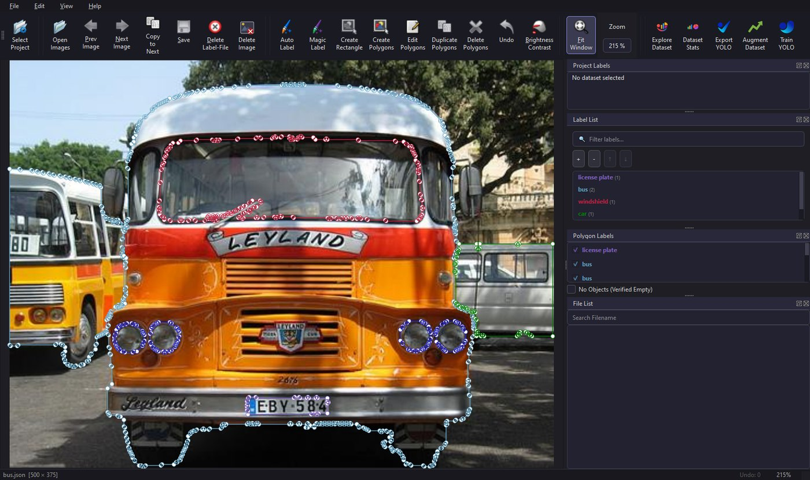
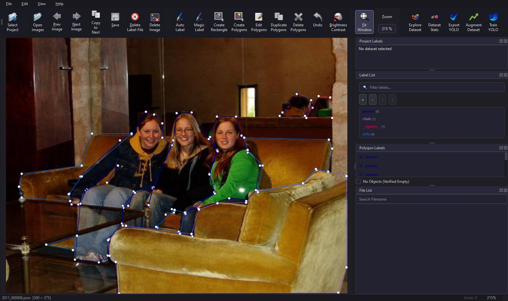
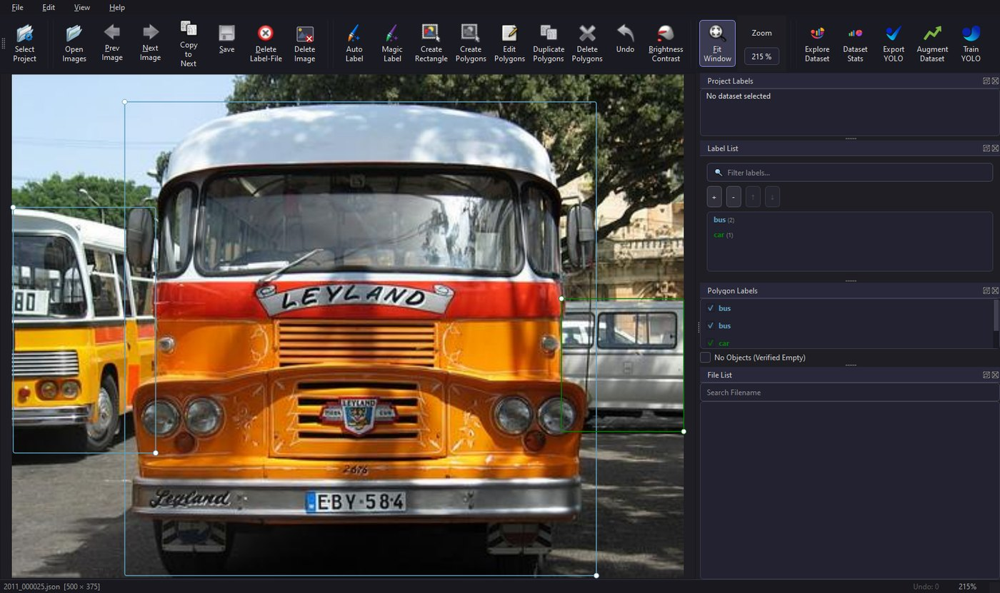
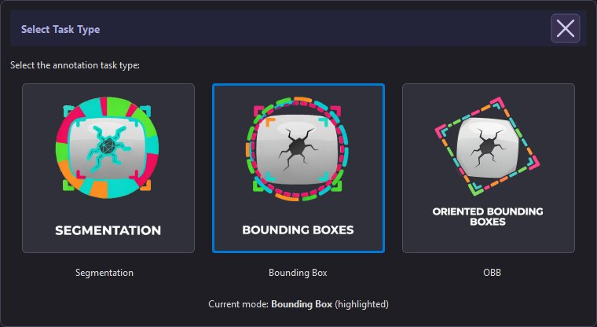

<div align="center">

# LabelYolo26

**Label images, build YOLO datasets and train YOLO26 models in one desktop app, with zero-shot auto-labelling from text prompts.**

[](LICENSE)




<sub>Magic Label on a sample image: the prompt <code>bus, car, headlight, license plate, windshield</code> gave 9 polygons with no trained model.</sub>

</div>

---

## Why LabelYolo26?

Training a custom YOLO model usually means juggling an annotation tool, conversion scripts, a training CLI and a lot of manual polygon clicking. LabelYolo26 puts the whole loop in one app:

```
 label (by hand, by text prompt or with your own model)  →  export YOLO dataset  →  train on GPU  →  auto-label more images  →  retrain
```

It is a fork of [labelme](https://github.com/wkentaro/labelme) 5.8.3, extended for production computer-vision work. I built it to cut annotation time on industrial inspection projects.

## Highlights

| | |
|---|---|
| **Magic Label (zero-shot)** | Type class names. **Grounding DINO** finds the objects and **SAM2** turns each box into a precise polygon. No trained model needed. GPU when available, CPU fallback. |
| **Auto Label** | Load your own YOLO weights and label the current image or a whole folder, with a confidence threshold. |
| **3 task types** | Segmentation (polygons), Bounding Box, and **Oriented Bounding Box (OBB)**. Menus, export and training follow the selected mode. |
| **Export YOLO** | Writes a ready-to-train dataset (`images/`, `labels/`, `data.yaml`) with a train/val slider. Merges classes with an existing dataset and updates images in place. |
| **Train & Retrain** | Train YOLO26 n/s/m/l/x or fine-tune existing weights. Live loss and mAP charts, per-class metrics, and an instant Cancel because training runs in its own process. |
| **Dataset tools** | Augmentation, a thumbnail dataset explorer, dataset and annotation statistics, and **Verified Empty** (`E`) for background images. |
| **Ships as an .exe** | Dark theme, standalone Windows build with PyInstaller. Operators can use it with no Python installed. |

## Screenshots

<table>
<tr>
<td width="50%"><br><sub><b>Segmentation:</b> polygon annotation with the AI tools in the toolbar</sub></td>
<td width="50%"><br><sub><b>Bounding Box:</b> detection labelling</sub></td>
</tr>
<tr>
<td colspan="2" align="center"><br><sub>Choose the task type at startup: Segmentation, Bounding Box or OBB</sub></td>
</tr>
</table>

## Quick start

**Requirements:** Python 3.11, Windows 10/11 or Linux, and an **NVIDIA GPU with CUDA** for training. CPU training is disabled on purpose. Magic Label and Auto Label also run on CPU, more slowly.

```bash
git clone https://github.com/ayhemmoussa/Labelyolo26.git
cd Labelyolo26

conda create -n labelyolo python=3.11 -y
conda activate labelyolo

# 1. PyTorch with CUDA (pick the index URL that matches your driver)
pip install torch==2.5.1 torchvision==0.20.1 --index-url https://download.pytorch.org/whl/cu121

# 2. The app (editable install) + Magic Label dependencies
pip install -e ./labelme
pip install transformers sam2

# 3. Run
labelme            # or: python -m labelme
```

Tested with `torch 2.5.1+cu121`, `torchvision 0.20.1`, `ultralytics 8.4.37`, `transformers 5.3.0`, `sam2 1.1.0`, `PyQt5 5.15.11`, `pyinstaller 6.16.0`.

### Model weights

Weights are not stored in git.

- **YOLO26 base models** (`yolo26n-seg.pt`, `yolo26n-obb.pt`, …) are downloaded by Ultralytics the first time you train. To bundle them into the `.exe`, put them in the repository root.
- **Magic Label models** are downloaded from Hugging Face on first use. To work offline or bundle them into the `.exe`, download them into `labelme/labelme/models/`:

  ```bash
  hf download IDEA-Research/grounding-dino-tiny --local-dir labelme/labelme/models/grounding_dino_tiny
  mkdir -p labelme/labelme/models/sam2
  curl -L https://huggingface.co/facebook/sam2-hiera-tiny/resolve/main/sam2_hiera_tiny.pt \
       -o labelme/labelme/models/sam2/sam2_hiera_tiny.pt
  ```

## Typical workflow

1. **Choose the task type** (Segmentation / Bounding Box / OBB).
2. **Open Images** from a folder.
3. **Select Project**: the folder where the YOLO dataset and training runs are written.
4. **Annotate** by hand, or speed up with **Magic Label** (text prompt) or **Auto Label** (trained model). Press `E` on images with no objects.
5. **Export YOLO** with your train/val split.
6. **Train YOLO**: pick model size, epochs, batch size, image size and GPU.
7. Use the new `best.pt` with **Auto Label** on more images, correct the results, re-export and **Retrain YOLO**. Each round needs less manual work.

The dataset folder ends up like this:

```
<dataset>/
├── data.yaml
├── .labels.json            # class list, kept in sync with the project folder
├── images/{train,val}/
├── labels/{train,val}/
└── runs/
    ├── train-seg/exp*/     # segmentation runs
    ├── train/exp*/         # bounding-box runs
    └── train-obb/exp*/     # OBB runs   (weights in exp*/weights/best.pt)
```

## How Magic Label works

```
text prompt ──► Grounding DINO (open-vocabulary detector) ──► boxes + labels
                                                                │
image ─────────────────────────────────────────────────────────►│
                                                                ▼
                                       SAM2 (box-prompted segmentation) ──► masks
                                                                ▼
                                    mask → polygon simplification ──► labelme shapes
```

Detected phrases are mapped back to your exact class names. If SAM2 is not installed, or fails on one object, that object falls back to a rectangle so you never lose a detection. The code is in [`labelme/labelme/magic_label.py`](labelme/labelme/magic_label.py).

## Building the Windows executable

1. Download the Magic Label models into `labelme/labelme/models/` (see above). The build won't run without them.
2. Delete any leftover `labelme/labelme/models/grounding_dino_tiny/.cache/` folder so partial downloads don't get bundled.
3. Optionally, put the `yolo26*.pt` base weights in the repository root.
4. Build:

```bash
cd labelme
pip install pyinstaller
pyinstaller LabelMe-YOLO-NoONNX.spec
```

The output goes to `labelme/dist/labelyolo26/labelyolo26.exe`. Ship the whole `labelyolo26/` folder. The build also puts `LICENSE`, `THIRD_PARTY_NOTICES.md` and `THIRD_PARTY_LICENSES.txt` next to the exe. Keep them with it, because the licenses require it (see [`THIRD_PARTY_NOTICES.md`](THIRD_PARTY_NOTICES.md)).

## Project structure

```
Labelyolo26/
├── labelme/                        # Python project (fork of labelme 5.8.3)
│   ├── labelme/
│   │   ├── __main__.py             # Entry point, dark theme, frameless dialogs
│   │   ├── app.py                  # Main window, menus, AI panel, batch labelling
│   │   ├── auto_label.py           # Trained-YOLO inference → labelme shapes
│   │   ├── magic_label.py          # Grounding DINO + SAM2 text-prompted labelling
│   │   ├── yolo_export*.py         # Export: segmentation / bbox / OBB
│   │   ├── yolo_train*.py          # Training dialogs: segmentation / bbox / OBB
│   │   ├── yolo_retrain*.py        # Fine-tuning from existing weights
│   │   ├── yolo_train_process.py   # Training subprocess entry points
│   │   ├── data_augmentation.py    # Dataset augmentation
│   │   ├── data_split.py           # Train/val split dialog
│   │   ├── explore_yolo.py         # Dataset thumbnail explorer
│   │   ├── stats_yolo.py           # Dataset statistics
│   │   ├── widgets/                # Canvas, label dialogs, AI prompt widget, …
│   │   └── models/                 # (git-ignored) bundled Magic Label weights
│   ├── LabelMe-YOLO-NoONNX.spec    # PyInstaller build spec
│   ├── rthook_torch_dlls.py        # PyInstaller runtime hook for torch DLLs
│   ├── pyproject.toml
│   ├── requirements-exe.txt
│   ├── tests/                      # Tests from the original labelme
│   └── examples/                   # Examples from the original labelme
├── docs/images/                    # README screenshots
└── yolo26*.pt                      # (git-ignored) base weights bundled into the .exe
```

## Contributing

Issues and pull requests are welcome. For a bug, include your OS, GPU / CUDA version, the task type, and the steps to reproduce it.

## License and credits

LabelYolo26 is a modified version of **[labelme](https://github.com/wkentaro/labelme)** by Kentaro Wada. It is licensed under **GPL-3.0** (see [`LICENSE`](LICENSE)).

It builds on **Ultralytics YOLO (AGPL-3.0)**, **PyQt5 (GPL-3.0)**, and **Grounding DINO** and **SAM 2** (Apache-2.0). See [`THIRD_PARTY_NOTICES.md`](THIRD_PARTY_NOTICES.md) for the full list, and for what the licenses mean if you share the app outside your organisation.

The screenshots use sample images from the labelme examples (PASCAL VOC 2011).

---

<div align="center">
Made by <a href="https://github.com/ayhemmoussa">Ayhem Moussa</a>, Computer Vision Engineer · <a href="https://linkedin.com/in/ayhem-moussa-55514a180">LinkedIn</a>
</div>
